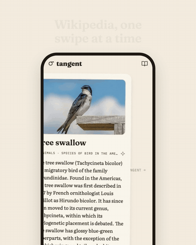

# Tangent

**Browse Wikipedia by swiping through its links.**

Try it at **[gotangent.app](https://gotangent.app)**. It's free in your phone's browser, and on a laptop you can drag or use `← → Enter`.



## How it works

You start in a feed of article cards picked from topics you like. **Swipe a card left** and a new column opens, filled with the articles that card links to, in the order they appear in the article. Swipe again from any of those to go one hop deeper. Swipe right to go back, tap to read.

- **Every hop is a real link.** A column is the seed article's own links, read section by section, with an occasional detour to an article in a different field that links back to it. When the links run out, Wikipedia's "more like this" search keeps the column going.
- **Each session is a Journey**, a saved tree of every hop and read. The Logbook keeps the topic stamps you've earned and the articles you kept with ✦.
- **No backend.** The app runs entirely on your device and talks to the public Wikimedia APIs directly. There are no accounts, and your journeys stay in your browser (IndexedDB) or on your phone (SQLite).

## Privacy

Tangent sends anonymous usage events to PostHog (US host) to judge feed quality: which columns keep people hopping and reading, and which they back out of. Those events (a card seen, a hop, a return, a read) include the **titles of the articles involved**. No other event carries a title. There are no accounts or person profiles, and session replay and GeoIP are off. On the web, autocapture and page addresses are off too. A feedback note is sent only if you write one.

To stop all of it, turn off **Settings → Share usage data**. Builds without a PostHog key send nothing.

## Built with

[Expo](https://expo.dev) and React Native, shipped to the web with `react-native-web` as a static site on Vercel. Native-only pieces have web twins behind the same interface: the reader's WebView becomes a sandboxed iframe, and `expo-sqlite` becomes `sql.js` with a snapshot in IndexedDB.

The [launch video](demo-video/) is made by a script. Playwright drives the production app with Wikimedia responses replayed from a HAR, so every take follows the same path, and Remotion cuts it together. After a UI change, retaking the video takes one command.

## Run it locally

```bash
npm install
cp .env.example .env.local   # then fill in your contact
npm run web                  # or: npm start, then press i / a for a simulator
```

| Variable | Required | Purpose |
|---|---|---|
| `EXPO_PUBLIC_WIKI_API_CONTACT` | yes | A URL or email for the `Api-User-Agent` header that [Wikimedia asks every client to send](https://meta.wikimedia.org/wiki/User-Agent_policy) |
| `EXPO_PUBLIC_POSTHOG_KEY` | no | PostHog project key. Without it, analytics is off. |
| `EXPO_PUBLIC_POSTHOG_HOST` | no | PostHog host. Defaults to `https://us.i.posthog.com`. |

Tests, lint, typecheck and the Lighthouse gate are covered in [CONTRIBUTING.md](CONTRIBUTING.md).

## Docs

- [SPEC.md](SPEC.md): what the app does and why. It's the source of truth for product decisions.
- [DESIGN.md](DESIGN.md): the visual design system.

## License

[MIT](LICENSE). Article text and images come from Wikipedia and Wikimedia Commons under their own licenses (mostly [CC BY-SA](https://en.wikipedia.org/wiki/Wikipedia:Text_of_the_Creative_Commons_Attribution-ShareAlike_4.0_International_License)).
